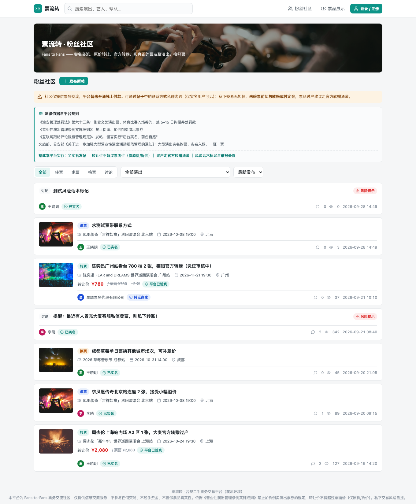
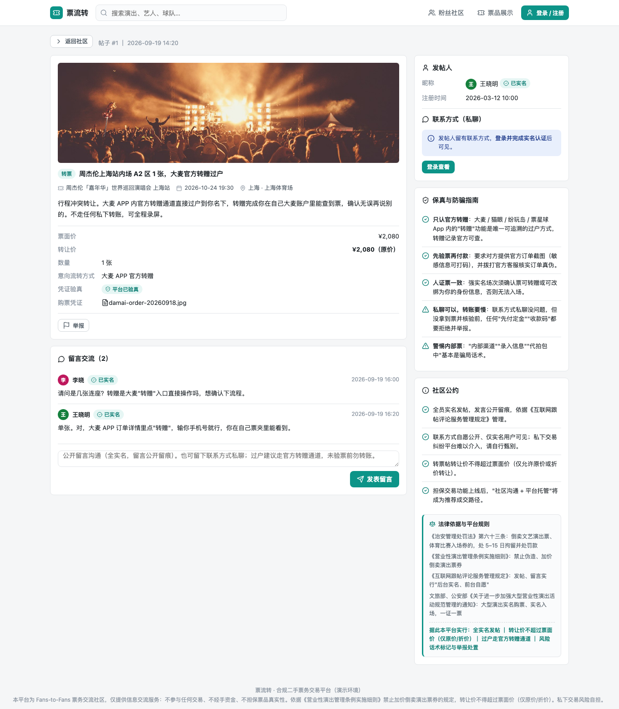
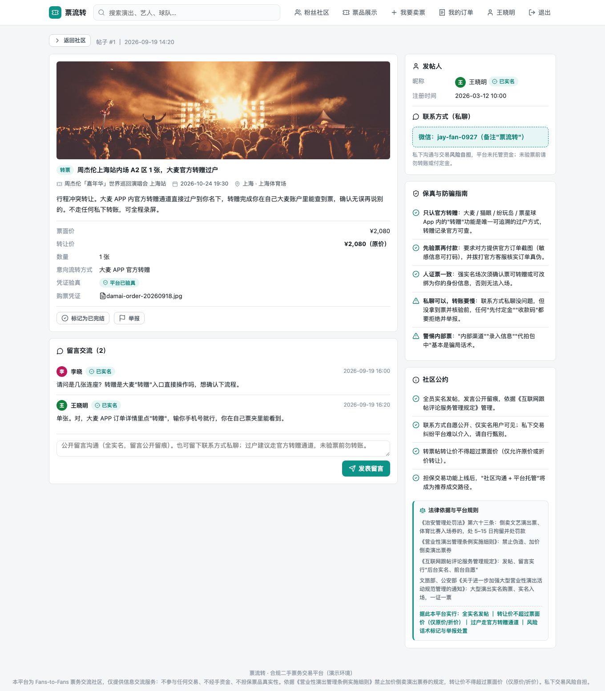
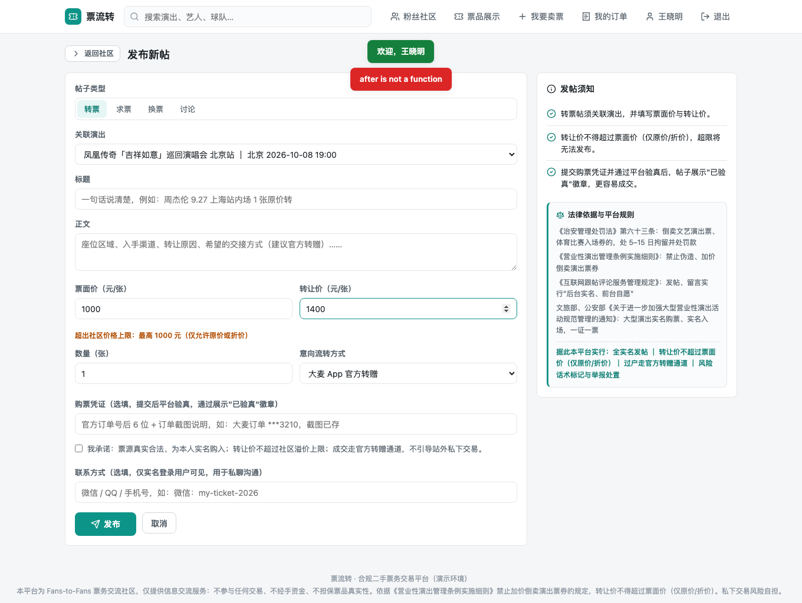
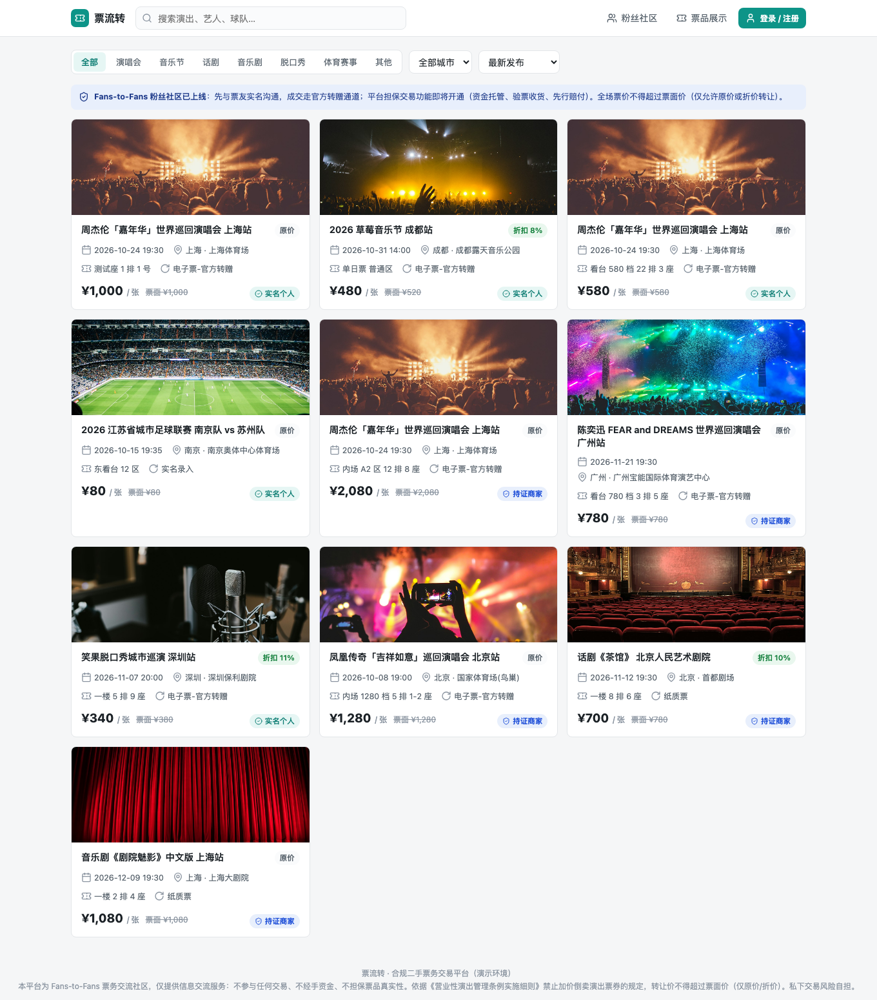
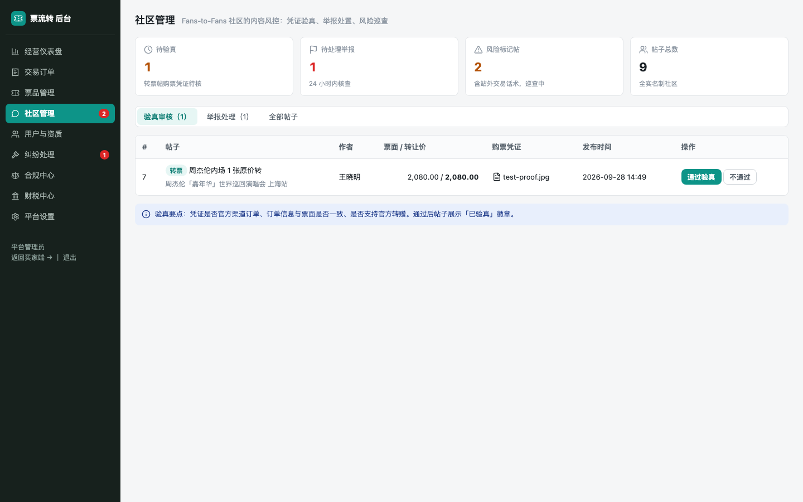
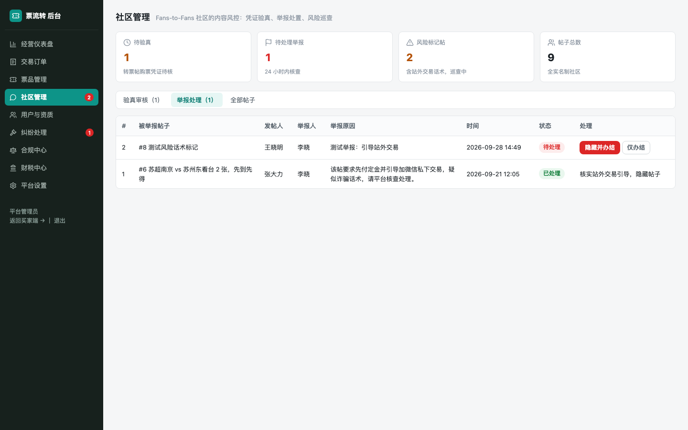
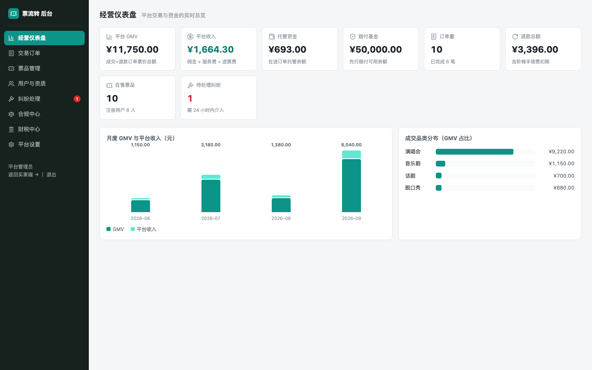
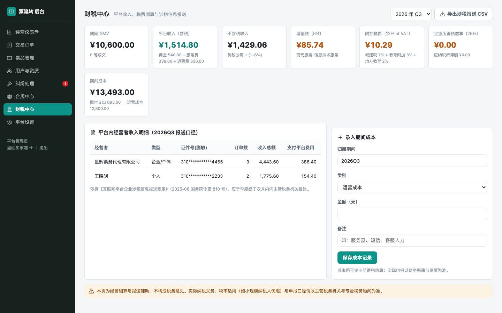

# 「票流转」作品说明（含 AI 工具使用说明）

> 版本：2026-10-07 ｜ 项目类型：全栈 Web 应用（Fans-to-Fans 票务交流社区 MVP）

---

## 一、作品概述

「票流转」是一个面向国内演出市场的二手票务交流平台。针对调研中发现的黄牛加价、假票诈骗、私下交易无保障三大痛点，当前版本以 **Fans-to-Fans 粉丝社区**为主站形态：粉丝实名发布转票/求票/换票/讨论帖，公开留言或互留联系方式私聊沟通，成交引导走官方转赠通道；**线上支付暂缓开通**，平台不经手任何资金，从机制上规避"二清"与集资风险。

核心设计原则：

- **原价封顶**：转让价不得超过票面价，服务端硬性拦截，管理后台也不可调高（合规红线写死在代码里）；
- **全员实名**：发帖、评论、查看联系方式均需实名登录，全程留痕；
- **凭证验真**：转票帖可提交购票凭证，平台人工验真后展示「已验真」徽章；
- **法律提示常驻**：社区列表、发帖页、帖子详情页、票品发布页均展示《治安管理处罚法》第六十三条等条文与平台规则的对应关系。

技术栈：零依赖 Node.js（内置 `node:http` + `node:sqlite`），原生前端 SPA（买家端 + 经营后台），无 npm 包、无构建步骤。数据全部存于单个 SQLite 文件。

## 二、功能清单与演示入口

| 模块 | 功能 |
|---|---|
| 粉丝社区（首页） | 四类帖子（转票/求票/换票/讨论）、类型徽章、风险标记、演出图片 |
| 帖子详情 | 票面价/转让价、已验真徽章、联系方式（仅实名可见）、公开留言、防骗指南、一键举报 |
| 发布新帖 | 关联演出、原价封顶校验（超限 422 拦截）、高危话术（定金/收款码/私下转账/押金）自动打标 |
| 票品展示 | 演出卡片图、票面价、原价封顶标识 |
| 经营后台 | 仪表盘（GMV/社区待办）、社区管理（验真审核/举报处理/帖子巡查）、票品/订单/用户/纠纷管理、合规中心、财税中心（增值税/附加税/企业所得税估算 + 涉税报送 CSV 导出）、平台设置 |

- 前台：http://localhost:8321/ （公网演示地址见 docs/DEPLOY.md）
- 经营后台：http://localhost:8321/admin
- 演示账号（手机号即登录）：管理员 18800000000 ｜ 个人卖家 13911112222 ｜ 买家 13955556666 ｜ 社区用户 13988889999

## 三、开发流程与 AI 工具使用说明

本项目由小组成员与 AI 编程助手 **Codex（OpenAI GPT-5，桌面版）**协作完成。AI 不是只用来"写代码"，而是贯穿了调研、方案、开发、验证、部署、文档六个环节；每个环节的关键决策均由小组拍板。各环节工具使用情况如下：

| 环节 | 使用的工具 | AI 承担的工作 | 小组承担的工作 |
|---|---|---|---|
| 1. 市场调研 | Codex + anysearch 联网检索技能 | 检索国内二级票务市场报道与监管文件（36氪、新华社、艾媒、消协等，原始素材存于 `research/`），归纳出黄牛加价、假票、退改难三大痛点 | 确定调研方向与目标人群，判断哪些痛点值得产品化 |
| 2. 产品与合规方案 | Codex | 起草平台机制（资金托管、强实名、原价封顶、阶梯退票、先行赔付）与合规文档（`docs/COMPLIANCE.md`、`docs/LEGAL.md`），指出"二清"红线、ICP/EDI 证要求 | **否决了 AI 最初"支付先行"的方案**，决定先做法规风险更低的论坛形态；确定原价上限锁定 1.0 不可调高 |
| 3. 前后端开发 | Codex | 生成全部代码：后端 `server/`（路由、数据库 schema、定价/结算/验真领域逻辑），前端 `public/`（买家端 SPA + 经营后台 SPA），约 60 个 API 与 20 余个页面 | 逐轮体验页面、提出修改意见（见第五节）、验收每个功能点 |
| 4. 测试与验证 | Codex 编写脚本 + Playwright | 编写 60 项端到端冒烟测试（`scripts/smoke.mjs`）与 30 项页面渲染断言 + 截图脚本（`scripts/forum-shots.py`），并实际执行、修复发现的问题 | 确认验收标准（"怎样算跑通"），复核截图效果 |
| 5. 部署上线 | Codex + Cloudflare 隧道 | 安装配置 cloudflared 快速隧道，编写一键启动脚本 `scripts/start-public.sh`、systemd 单元与 Nginx 配置，对公网地址重跑全部测试 | 决定采用"临时隧道先演示、VPS 方案备用"的策略 |
| 6. 文档整理 | Codex + pandoc/xelatex | 撰写 README、部署说明、本说明文档，并用 pandoc 将 Markdown 转为纯文本与 PDF | 明确文档的提交格式要求 |

补充说明：anysearch 是 Codex 的一个"联网检索技能"，用于第 1 环节获取真实市场资料；Playwright 是浏览器自动化工具，AI 编写并运行验证脚本；Cloudflare、pandoc 为普通工具，由 AI 调用。页面所用图片素材来自 Unsplash 免费图库（非 AI 生成，见第五节取舍 4）。

## 四、关键步骤截图

以下截图由 `scripts/forum-shots.py` 自动截取（存于 `scripts/shots/`），同时也是自动化验证的一部分。

**图 1 ｜ 首页即粉丝社区**：演出横幅图、四类帖子卡片、类型/风险/已验真徽章、顶部的法律依据提示块。

**图 2 ｜ 帖子详情页（已验真转票帖）**：票面价与转让价（原价封顶）、「已验真」徽章、防骗指南面板、公开留言；游客访问时联系方式处于锁定状态。

**图 3 ｜ 实名用户可见联系方式**：登录并实名后，发帖人自愿公开的联系方式（微信/QQ/手机）解锁可见，旁边仍有"私下交易风险自担"提示。

**图 4 ｜ 发布新帖**：关联演出、票面价/转让价（超限被服务端 422 拦截）、购票凭证上传、联系方式选填，页面常驻法律依据提示。

**图 5 ｜ 票品展示页**：演出卡片图 + 原价封顶标识，为后续担保交易预留的展示位。

**图 6 ｜ 经营后台 · 社区管理（验真审核）**：管理员对购票凭证做人工验真，通过/拒绝即时生效。

**图 7 ｜ 经营后台 · 举报处理**：用户一键举报的帖子在此处置，可隐藏帖子并办结，形成内容治理闭环。

**图 8 ｜ 经营后台 · 仪表盘**：GMV、平台收入、托管资金、赔付基金与社区待办角标一屏总览。

**图 9 ｜ 经营后台 · 财税中心**：增值税、附加税、企业所得税估算，支持按 810 号令要求导出涉税报送 CSV。

## 五、AI 提供的建议与小组的判断、取舍

| # | AI 的建议 | 小组的判断与取舍 | 理由 |
|---|---|---|---|
| 1 | 第一版方案包含完整担保交易（支付 → 托管 → 结算），建议"交易闭环先行" | **否决，暂缓支付，先做纯论坛** | 无支付牌照做资金托管属于"二清"红线，法律风险远大于功能收益；论坛形态平台不经手资金，可先合法跑起来 |
| 2 | 将价格上限做成后台可自由调整的配置项 | **采纳配置化，但服务端锁死在 0–1.0，管理端不可调高** | 加价倒卖是被《营业性演出管理条例实施细则》明确禁止的行为，上限若可被人为调高，合规红线形同虚设 |
| 3 | 把"微信、QQ、支付宝"全部列为发帖风险词 | **部分采纳：收窄为"先付定金/收款码/私下转账/押金"四类资金高危词** | 实测发现粉丝正常沟通（互留微信）被大面积误伤；风险词应针对"骗钱动作"而非"沟通工具" |
| 4 | 用 AI 生成全部页面配图 | **放弃，改用 Unsplash 免费可商用图库** | 当前环境无图像生成 API 额度；且真实演出场景图比 AI 生成图更可信，也避免 AI 图的版权争议 |
| 5 | 发帖人联系方式公开展示，方便沟通 | **修正为"仅实名登录用户可见"，游客见锁定提示** | 手机号/微信属于个人信息，《个人信息保护法》要求最小必要公开；实名可见既保沟通又留痕可追责 |
| 6 | 演示阶段保留"手机号即登录"以方便体验 | **采纳，但在部署文档中明确标注：上线前必须替换为短信验证码 + 密码哈希** | 演示效率与生产安全的权衡，前提是风险写清楚、不带到正式环境 |

## 六、基于反馈的修改（迭代记录）

**修改 1（功能转向，最重要的一次）**：初版交付后，小组体验时提出——"先做成 fans to fans 论坛，先不上支付，让用户能在上面进行票务沟通交流；票务保真问题要有处理办法"。AI 据此完成了三方面改造：首页从票品列表改为社区信息流；票品卡的"立即购买"按钮替换为"去社区沟通这张票"（交易 API 保留但入口隐藏，为支付上线留路）；新增"保真三板斧"——实名发帖留痕、购票凭证人工验真徽章、官方转赠通道引导。改完后 60 项端到端测试全部重跑通过。

**修改 2（合规强化）**：小组复查合规文档后反馈——"把上限设成 1.0，并把法律条文放在页面的提醒位置"。AI 将 `price_cap_multiplier` 固定为 1.0 并在服务端 clamp（即使管理员在后台提交更大值也会被压回 1.0）；同时抽取 `legalNote()` 组件，在社区列表、发帖页、帖子详情、票品发布页四处常驻展示《治安管理处罚法》第六十三条等条文与平台规则的对应关系（见图 1、图 4 顶部提示块）。

**修改 3（体验优化）**：小组体验公网页面后反馈——"页面太素，丰富一下，加入图片"。AI 原计划用图像生成模型出图，因无 API 额度改为下载 9 张 Unsplash 免费演出场景图存入 `public/img/`，为演出数据增加图片字段，实现首页横幅、帖子缩略图、详情页演出横幅、CSS 首字头像；同时修复了静态服务缺少 `.jpg` MIME 类型导致图片被当作下载文件的问题。用 Playwright 断言确认全部图片真实渲染（`naturalWidth > 0`），效果见图 1、图 2、图 5。

## 七、反思与不足

1. **AI 的方案需要人来把合规关**。AI 第一版就把支付闭环做完了，功能上很完整，但如果没有小组对"二清"红线的判断，直接上线就是法律事故。我们学到的最重要一课：AI 给出的"能跑"的方案，不等于"能上线"的方案。
2. **风险词误伤是 AI 想不到的**。把"微信"列为风险词在逻辑上说得通，但只有真实使用场景才能暴露误伤问题——规则类功能必须经过真人实测。
3. **当前不足**：演示登录不具备生产安全性；内容审核依赖人工巡查，量大后需要接入机审；SQLite 单文件在并发量上来后需要迁移；图片为外链素材的本地化副本，正式环境需确认每张图的授权范围。
4. **AI 最大的价值在"加速验证"而非"代替决策"**：60 项冒烟测试 + 30 项页面断言由 AI 编写并反复执行，让每一轮修改都能在几分钟内确认没有改坏旧功能，这是纯人工开发很难维持的节奏。
